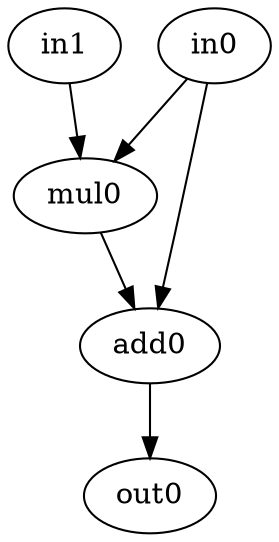

# 10 — 接入 CGRA-ME（A 阶段记录）

> 目标：用开源 CGRA 编译器（CGRA-ME，多伦多大学）替代手写微码的"调度那一层"。
> 本文只记录 **A 阶段（拿到工具、跑通最小示例）** 的结论，B/C 阶段见路线图。

## 1. 许可（重要）

CGRA-ME 不是开源许可证，而是它自带的 **EULA**：

- 仅允许 **非商业、非营利研究**；
- **禁止以源码或二进制形式再分发**；
- 不得用于商业 CGRA/软核架构开发，商业用途需作者书面同意。

因此它被放在 **仓库外**（`~/cgra-me`，24 MB），**不进入 `third_party/`、不提交**。
本项目的 arch 描述、后端与运行时是我们自己的代码，可正常入库。

## 2. 构建（本机实测）

```bash
git clone --depth 1 https://github.com/shariethernet/CGRA-ME.git ~/cgra-me   # 社区镜像
cd ~/cgra-me
env -u LD_LIBRARY_PATH cmake -S . -B build -DCMAKE_BUILD_TYPE=Release
env -u LD_LIBRARY_PATH cmake --build build -j8
```

- **不需要 LLVM pass**（`CGRA_ME_BOOTSTRAP_LLVM_PASSES` 默认 OFF）；
- 运行需要它自带的 SCIP：`LD_LIBRARY_PATH=~/cgra-me/build/lib`；
- 若扫描器/解析器与本机 flex/bison 不兼容，用本机重新生成：
  `flex -o dfgdot.yy.cc dfgdot.l` + `bison -d --defines=dfgdot.tab.h -o dfgdot.tab.cc dfgdot.y`。

## 3. CLI 的问题（已绕过）

`cgrame -x arch.xml -g dfg.dot` 会在**读完架构后 CPU 空转**（用三组独立探针复现：
不存在的 DFG、空 DFG、正常 DFG 全都挂；`-x` 单用时正常退出）。
不是 DFG 格式问题，也不是 stdin。

## 4. 库接口（可用路径）

`inc/CGRA/*.h` 的关键 API：

| 用途 | 签名 |
|---|---|
| 读架构 | `adl0::parseADL(std::string arch)` / `adl1::parseADL(template, arch)` |
| 读 DFG | `std::unique_ptr<OpGraph> parseOpGraph(std::string dot)` |
| 建 Mapper | `Mapper::createMapper(MapperType, shared_ptr<CGRA>, timelimit, args)`，`MapperType{ILPMapper=0, AnnealMapper=1}` |
| 映射 | `Mapping mapOpGraph(shared_ptr<OpGraph>, int II)`；`isMapped()` / `getII()` |

## 5. DFG 的 dot 格式（实测确定）

- 节点属性：`input=1`（输入）、`output=1`（输出）、`opcode=mul`（运算）、可选 `cycle=N`；
- 边属性：`operand=k`；
- **属性值不要加引号**：写成 `[operand="0"]` 会让解析器 `std::stoi("\"0\"")` 抛
  "Invalid argument: stoi"（CLI 卡死的真正原因）。



## 6. AnnealMapper 的参数（实测必需）

`AnnealMapper.cpp` 用 `args.at(...)` 取六个键，缺一个就抛异常：

```
AnnealMapper.random_seed / initial_pfactor / pfactor_factor /
constant_temp_factor / swap_factor / cold_accept_rate
```

## 7. 结果（A 阶段收尾）

用 30 行 C++ 驱动（`adl0::parseADL` → `parseOpGraph` → `createMapper` → `mapOpGraph`）：

```
[drv] parsing architecture...
[drv] parsing DFG...
[drv] creating mapper (Anneal) for II=1
Current Cost is: 60
Mapped: 0
[drv] mapped=no II=1
```

即 **工具链、架构解析、DFG 解析、Mapper 调用全部打通**；`mapped=no` 是退火在 40 s /
II=1 下没找到合法映射（正常结果，不是流程错误）。

### 7.1 换 `ILPMapper`（SCIP）后：纯算子 DFG 能映射成功

同一份驱动改成 `MapperType::ILPMapper`（ini 里 `ilp_solver=scip`）后，**纯算子 DFG 全部成功**：

| DFG | 算子数 | 架构 | II | 结果 |
|---|---|---|---|---|
| `add0` 单个 | 1 | simple 2×2 | 1 | `optimal` |
| `add0→add1`（operand 1） | 2 | simple 2×2 | 1/2 | mapped |
| `add0,add1→add2` 双生产者 | 3 | simple 2×2 | 1 | `optimal` |
| `fir4`（4 mul + 3 add 树） | 7 | simple 2×2 | 2 | mapped，cost 83 / 下界 78（gap 6.4%），7 个算子落在 `block_2_2_`、`block_1_1_`、`block_2_1_`、`block_1_2_` 四个 PE、0/1 两拍 |
| `fir8`（8 mul + 7 add） | 15 | simple 2×2 | 4 | mapped |
| `fir4` | 7 | **GPCP 8×8**（每跳 1 拍） | 1 | mapped，3.4 s，cost 279，7 个算子分布在 5 个 PE（0 拍） |

`mapOpGraph` 返回的 `Mapping` 带完整结果：`outputMapping()` 打出每个算子落在
`cycle:block_row_col.func.fu`，以及每条 val 的逐跳布线（`conN_muxM.inK → mux → out → func.in_a`）。
也就是说 **"II + 映射摘要"这条 A2 验收已经拿到**。

### 7.2 重要限制：带 `input=1` 节点的 DFG 一律判 infeasible（本版本）

对照实验（`arch-homo-diag` / `arch-homo-orth` / `arch-hetero-diag` × ILP 与退火 × II=1/2）：

| DFG | 结果 |
|---|---|
| `in0 [input=1]` 单独 | `optimal` |
| `out0 [output=1]` 单独 | `optimal` |
| `add0 → out0` | mapped |
| `in0 → add0` | **infeasible** |
| `in0, in1 → mul0 → add0 → out0`（最小 DFG） | **infeasible**（两个 mapper 都一样） |

原因在 IO 模块的内部连线（`src/core/Module.cpp:1141-1145`）：
`this.in → reg_in → OE.in`（输出方向通），`OE.out → this.bidir`（输入方向只到 `bidir`，
而阵列取数走 `this.out`，要绕 `bidir → reg_out → this.out` 两跳寄存器），这一版约束建模
没有给输入侧留出这条合法路径。

**结论（对我们的流程）**：本版本不要用 `input=1` 节点描述数据入口；真实 kernel 的入口
用 `load`/`store` 类算子（对接我们的 spad）或者干脆用纯算子 DFG 先做容量/II 评估。

### 7.3 退火映射器（AnnealMapper）的完整实验：不能用于我们的 DFG

跑法：`/tmp/drv2`（等价于 `cgra/tools/map.sh`）在 `arch-homo-orth.xml`（2×2）与
`cgra/arch/gpcp-8x8-mesh.xml`（8×8）上，II=1/2/4，时限 30/60/300 s。

| DFG | 架构 | II | 时限 | 结果 |
|---|---|---|---|---|
| `fir4`（7 算子，末 val 悬空） | 8×8 | 1 | 30 s | **段错误**（`Initial placement` 之后） |
| 单个 `add0`（无输出 val） | 8×8 | 1 | 20 s | **段错误** |
| `fir4_closed`（8 算子，含自环 sink） | 8×8 | 1 | 60 s | `mapped=no` |
| 同上 | 8×8 | 2 | 60 s | `mapped=no` |
| 同上 | 8×8 | 1 | **300 s** | `mapped=no`，cost 停在 2556（OpGraph）/1535（MRRG） |
| `fir8_closed`（16 算子） | 8×8 | 1、2 | 60 s | `mapped=no` |
| `fir4_closed` | 2×2 | 2、4 | 30 s | `mapped=no`，cost 988→909（不收敛） |

两个根因（都用 gdb 定位）：

1. **悬空 val / 无输出算子直接崩**：`AnnealMapper::routeOp`（`src/core/AnnealMapper.cpp:925`）
   对每个非 output/store 的算子无条件调 `routeVal(op->output)`，而 `routeVal`（`:365`）
   又直接解引用 `val->input`。Release 构建里 `assert` 被关掉 → 空指针。
   `cgra/tools/gen_dfg.py ... --close` 用一条 `sink -> sink` 自环把最后一个 val 接上即可不崩
   （自环在 II=1 时正好走 PE 内的寄存器，1 拍回绕）。
2. **不收敛**：即使不崩，8×8 上 300 s 的 cost 仍在 2556，比 2×2 的 909 还大；
   说明退火在"大架构 + 多输入 mux"的搜索空间里几乎没有进展（move set 只换 PE/拍，
   布线靠 `routeVal` 的贪心 BFS，找不到就整步丢弃）。

**结论**：大架构只用 **ILP（SCIP）**；退火当作"小图快速试算"的工具都不合格。

### 7.4 ILP 的实用规模阈值（每跳 1 拍的 GPCP arch，60~100 s 时限）

| DFG | 算子数 | 架构 / II | 结果 |
|---|---|---|---|
| `fir4` | 7 | 8×8 / 1 | `mapped=yes`，3.3 s，cost 279 |
| `fir6` | 11 | 8×8 / 1 | **60 s 超时** |
| `fir6` | 11 | 4×4 / 1 | `mapped=yes`，12.9 s |
| `fir6` | 11 | 3×3 / 2 | `mapped=yes`，14.2 s |
| `fir8` | 15 | 8×8 / 1、2、4 | 全部超时且 0 个可行解 |
| `fir16` | 31 | 2×2 / 8、16（自带 arch，无延迟） | 超时 |

注意 `fir8` 在 8×8 上**容量绰绰有余**（15 个算子 vs 64 个 PE），超时是因为
SCIP 求**首个可行解**时根节点 LP 就要 8~9 万次迭代（26k 变量 / 32k 约束），
启发式一直没机会跑。**阵列越大越对称、越难找第一个解**（§10.2 的 3×3/4×4/8×8 对照
把这点量化了）：同样的 11 算子图，8×8 超时、4×4 13 s。
也就是说：**瓶颈在求解策略与阵列对称性，不在阵列规模**。

## 8. B 阶段：8×8 架构与映射验证（已落地）

依据 `docs/02` / `docs/11` 的规模估算（NR 20 MHz SISO ≈16 GOPS，8×8@500 MHz 峰值 ≈64 GOPS，
3~4× 余量），B 阶段第一步已经完成：

| 文件 | 内容 |
|---|---|
| `cgra/arch/gpcp-8x8-mesh.xml` | CGRA-ME ADL：8×8 PE（`col=10 row=10 cgra-cols=8 cgra-rows=8`，四周一圈 IO），PE = 8 输入 mux + `FuncUnit(add sub mul and or xor shl shr)` + 寄存器；N/E/W/S 四邻域 |
| `cgra/tools/cgrame_map.cpp` | 我们的库驱动（避免 CLI 空转），`[section]` 前缀展开 ini、强制 SCIP |
| `cgra/tools/map.sh` | 编译 + 运行包装（`CGRA_ME_HOME` 默认 `~/cgra-me`） |
| `cgra/tools/gen_dfg.py` | 生成 `firN` DFG（加法树 + N 个 mul） |
| `cgra/dfg/fir4.dot` / `fir8.dot` / `fir16.dot` | 示例 DFG |

用法：

```bash
env -u LD_LIBRARY_PATH python3 cgra/tools/gen_dfg.py fir 16 cgra/dfg/fir16.dot
bash cgra/tools/map.sh cgra/arch/gpcp-8x8-mesh.xml cgra/dfg/fir16.dot 1 ilp 400
# 退火要求 DFG 没有悬空输出（否则段错误，见 §7.3）：
env -u LD_LIBRARY_PATH python3 cgra/tools/gen_dfg.py fir 8 /tmp/fir8_closed.dot --close
```

实测结论：

1. 8×8 架构**能解析、能映射**（`fir4` II=1，3.4 s 出解，cost 279，7 个算子落在 5 个 PE）；
2. ILP 的瓶颈是**求首个可行解**，不是容量：7 个算子 3.3 s 出解，11 个以上在 8×8 上超时
   （同样的 11 算子图在 4×4 上 12.9 s 就出解，见 §7.4）；
   因此工业级规模要换求解策略（热启动/对称性破除/分层映射），这也是 C 阶段后端要解决的问题；
3. 2×2 的 II 阶梯（容量对照）：`fir4` → II=2，`fir8` → II=4，`fir16` → II≥8 且 90 s 超时——
   与"每个 PE 每拍 1 个算子 + 布线占用"的估算一致，可用来反推 N×N 的规模。

## 9. 下一步（C 阶段）

1. 映射结果 → 微码：把 `Mapping` 的 `cycle:block_r_c.func.fu` 转成我们 512×512 IMEM 的
   `(cycle, pe)` 槽位，把布线转成 `src_a/src_b/link` 选择（与 `tools/cgra.py` 的
   `Program.set` 逐位对齐后才切换）；
2. spad 访问：DFG 里的 `load`/`store` 算子映射到 `spad` bank（先在 ADL 里加 memory tile，
   再在运行时做 DDR↔spad 的 DMA 双页 ping-pong，见 `docs/07` §4）；
3. 调度/交接层（M1 运行时）：`spad_acquire/release(page)`、`dma_in/out_barrier()`，
   目标是让现在卡住的"52 块串行 × 8 迭代"逐位一致（`docs/09` §4.3 的结论）。

## 10. 切块实验：LDPC 的 24 槽 BN 交给 ILP（本轮结论）

既然整图 ILP 只到 ~11 个算子（§7.4），就按"**切成 ≤9 算子的子块、每块单独映射**"试一次。
对象是真实 BG2 的变量节点：最大列度 **23**（`sw/include/ldpc_bg2.h` 的 42×52 基图实测，
所以流式 BN 微码用 24 个槽、第 24 槽补零），每个提升行的数据流是

```
acc  = msg[0] + ... + msg[22] + llr      # 24 个叶子（真机是 24 条 LD）+ 23 个 ADD
out_k = acc - msg[k]  (k = 0..22)        # 23 个 SUB（每条边各读一次 acc）
hard = acc >> 31                         # 1 个 SHR
```

工具：`cgra/tools/bn_chunks.py`（自动切块 → 生成 dot → 逐个调 `map.sh` → 汇总 CSV）。

### 10.1 切法（18 片，126 个算子含 LD）

| 片名 | 内容 | 算子数 |
|---|---|---|
| `g1_0..g1_5` | 第一层：每片 4 条（末片 3 条）msg 的加法链 | 7 / 7 / 7 / 7 / 7 / 5 |
| `g2_a` / `g2_b` | 第二层：合并 4 个部分和 / 3 个部分和 + llr | 7 / 5 |
| `g3_acc` | 第三层：两个部分和相加得到 acc | 3 |
| `sub_0..sub_7` | 减法片：每片 3 条边（末片 2 条）：`C_j`、`m_k`、`SUB` | 9 ×7 / 6 |
| `hard` | 硬判决：`acc >> 31` | 2 |

### 10.2 结果：3×3 上 18/18 全部映射成功（48 s）

```bash
python3 cgra/tools/bn_chunks.py --arch cgra/arch/gpcp-3x3-mesh.xml \
        --out build/bn_chunks3 --ii 1 --limit 45
```

| 片 | 求解时间 | 结果 |
|---|---|---|
| `g1_*`（7 算子） | 3.2~3.5 s | mapped |
| `g1_5`、`g2_a/b`（5~7 算子） | 0.15~3.2 s | mapped |
| `g3_acc`（3 算子） | 0.06 s（optimal） | mapped |
| `sub_0..sub_6`（9 算子） | 3.7~4.0 s | mapped |
| `sub_7`（6 算子） | 0.43 s（optimal） | mapped（但取不出落点，见 §10.3） |
| `hard`（2 算子） | 0.01 s | mapped |
| **合计** | **48.4 s** | **18/18** |

**阵列越小越快**（同一片、同一时限）：

| 子块 | 3×3 | 4×4 | 8×8 |
|---|---|---|---|
| `g2_a`（7 算子） | 1.8 s（optimal） | 0.58 s | 30 s 超时、0 个解 |
| `sub_0`（7 算子，旧切法，扇出 3） | 24.8 s | 45 s 超时 | 60 s 超时 |

结论：**块 ≤9 算子 + "最小可容纳的阵列" → ILP 秒级出解**；阵列越大越对称，
SCIP 越难找到第一个可行解（这是 §7.4 里"瓶颈在求解策略"的具体表现）。
所以正确用法是 `tile-and-place`：小块在 `gpcp-3x3-mesh.xml` 上映射，再整体搬到 8×8 的实际位置。

### 10.3 实验中发现的三个"必须修/不能碰"的建模问题

1. **扇出 ≥3 的 val 取不出落点**。`sub` 片一开始让 3 个 SUB 共享同一个 `acc` 叶子：
   求解是成功的（`mapped=yes`，cost 106），但 `outputMapping()` 抛 `map::at`；
   换成驱动里自己读 `getMapping()` 后，`sub_7` 在 **optimal** 解上都打印"全部 unmapped"
   （`SCIPgetSolVal(...)==1.0` 取不到值）。**对策**：切块时每个消费者单独一个叶子
   （真机上本来就是每条边各读一次 spad），扇出就降到 1，落点全部可取出。
2. **原来的 ADL 允许"同拍组合直连"**。PE 的 `this.out` 可以直通 `func_out`（绕过寄存器），
   于是 ILP 把 7 个算子全放在同一拍、89 条边全部"同拍"——这在我们的 RTL 里做不到
   （PE 只有 1 拍延迟的 link 寄存器，`docs/02` §1.1）。**已修**：两个 arch 文件都改成
   `register.out → this.out`（每跳 1 拍），改完 18/18 仍然秒级 mapped，
   这时 II=1 + 全同拍就等价于"每拍处理一行"的流水，物理可实现。
3. **退火不能用**（§7.3）：悬空 val 段错误、8×8 300 s 不收敛。

### 10.4 对我们后端的意义

- 切块的**编译成本可接受**：126 个算子 / 18 片 / 48 s，一次性；
- 但 **CGRA-ME 不能当后端**：它能可靠回答"这一块能不能映射、II 是多少"，
  却给不出稳定可靠的"算子 → PE/拍"落点（§10.3-1），更谈不上把落点转成我们的微码；
- 所以 C 阶段还是得自己写后端：
  ① 块内落点/拍号：按"数据依赖层号 = 拍号"的规则映射（块都很小，规则映射即可），
     ILP 只作为"可行性 + II 参考"；
  ② 块间交接：每片的结果写 spad、下一片再读（就是 M1 运行时的 `spad_acquire/release`）；
  ③ 拍数估算：手写 BN 微码是 **125 拍/行**（16 个 PE 并行 16 行，串行链）；
     切块版每片约 4 拍（链深），但 18 片必须串行 + 每片之间 spad 往返，
     量级相当，而面积利用率（每片只用 3×3~9 个 PE 中的一部分）明显更差。
     所以**切块能验证流程，但不会更省**——真正的收益要等"整图调度 + 块间流水重叠"
     （即块与块并行、不同行错开）之后才有。

## 11. 规则映射器原型 v0（已硬件验收）

`cgra/tools/rule_map.py`：**DFG → 本项目微码**，自带一个按 ISA 语义写的周期级模型做自检。

### 11.1 规则（刻意保持简单、可解释）

1. **拍号 = 指令顺序**：一个 PE 上按拓扑序串行发射，每条指令 1 拍；
2. 算子结果留在寄存器（r0..r7 线性扫描分配并做"最后使用即释放"，8 个够用），
   只有叶子（LD）与汇（ST）访问 scratchpad；
3. **并行只来自"数据实例"**：第 w 个实例跑在第 w 个 PE 上（BN 里 w = 提升行号），
   与手写 BN 微码的并行方式一致（1 个 PE = 1 个变量节点）；
4. spad 布局与手写 BN 相同：`msg_k → bank k`、`llr → bank 24`、减法结果原位写回、
   硬判决 → `bank 25`；切块里的 acc 叶子（`C_j`/`P/Q`）放 bank 26..31。

v0 明确**不做**：link 路由、跨 PE 共享算子、块间流水重叠、寄存器 spill。

### 11.2 结果

```
$ python3 cgra/tools/rule_map.py --bn
ldpc_bn: 71 个算子 / 24 个叶子 / 24 个汇，依赖深度 24
  微码 118 拍 × 16 PE（每个实例 1 个 PE，共 16 个实例）
  自检：384 个 spad 值，差异 0 个

$ python3 cgra/tools/check_rule_bn.py          # Verilator 台架逐值对账
微码 118 拍；台架跑完 832 个 spad 字；对账 384 个值，差异 0 个
```

- **118 拍 × 16 PE**，24 槽 × 16 行全部逐值正确（硬件级，不只模型级）；
- 手写微码是 **125 拍**（`sw/soc/pdsch_bn1_bm.c` 的 `CYC_BN=130` 预算）——规则映射
  比手写少 7 拍，因为不补零第 24 槽、也不重复读 acc。

18 个切块（§10.1）单独跑规则映射 + 模型自检：**18/18 通过**，每片拍数：

| 片 | 拍数 | 片 | 拍数 |
|---|---|---|---|
| `g1_0..g1_4` | 8 | `sub_0..sub_6` | 12 |
| `g1_5` / `g2_b` | 6 | `sub_7` | 8 |
| `g2_a` | 8 | `g3_acc` | 4 |
| `hard` | 3 | **18 片串行合计** | **159** |

注意：**整图不切块的规则映射只要 118 拍**，比 18 片串行（159 拍）还少——
因为切块后每片都要重新读 acc、部分和还要多走一趟 spad。切块只是为了迁就 ILP 的规模，
规则映射不需要它。

## 12. link 版（v1）：4 个 PE 处理一行，31 拍 / 4 行

`schedule_bn_split()`：一行拆到 **4 个横向相邻的 PE**（4 行/次，正好 16 个 PE 全用上），
消息按 6+6+6+6 分组（24 槽 = 真实最大列度 23 + 1 个补零槽，与 `pdsch_bn1_bm.c` 的
`BNSLOT=24` 一致），**每组 6 条全部常驻寄存器**（省掉了第二次读 spad），
部分和与 acc 走 link（1 跳 1 拍）。

时间线（j = 0..3 是 PE 列，se = 2*6-1 = 11 是最后一个 ADD 的拍）：

| 拍 | 动作 |
|---|---|
| 0~5 | 每组 LD 自己那 6 条 msg → r1..r6 |
| 6~11 | `MOV r0=r1`，然后 5 个 `ADD r0 += r_i` → 各组部分和 |
| 12 | p2 收 p3 的部分和（link `e`） |
| 13 | p1 收 p2 合并后的值；p0 读 llr → r7 |
| 14 | p0 加 llr |
| 15 | p0 收 p1 合并后的值 = **acc** |
| 16~18 | p0 硬判决 + 存 bank 25；acc 沿 link 从 p0 广播到 p3（每跳 1 拍） |
| 17~30 | 每个 PE 对自己的 6 条边做 `SUB` + `ST`（2 拍/边） |

（23 槽版本是 30 拍/pass；现在用 24 槽，最后一组也是 6 条，相位顺延 1 拍 → 31 拍。）

结果（模型 + **Verilator 台架** + **CVA6 SoC 基准**都验过）：

```
$ python3 cgra/tools/rule_map.py --bn-split
ldpc_bn/split4: 每行 4 个 PE、每次 4 行；20 行 = 5 pass，微码 155 拍 × 16 PE
  自检：500 个 spad 值，差异 0 个

$ python3 cgra/tools/check_rule_bn.py --split
微码 155 拍；台架跑完 832 个 spad 字；对账 500 个值，差异 0 个
```

| 版本 | 结构 | 20 行（Zc=20）的总拍数 | 相对手写 |
|---|---|---|---|
| 手写微码 | 1 PE/行，16 行/次，2 次运行 | 2 × 125 = **250** | 1.00× |
| v0（§11 规则版） | 1 PE/行 | 2 × 118 = **236** | 1.06× |
| v1（link 版） | 4 PE/行，4 行/次 | **155** | **1.61×** |

为什么 v1 突然变快？不是 link 本身，而是 **k=4 恰好让"每条边 6 个消息"塞进 8 个寄存器**：
减法阶段不用再从 spad 读一遍 msg（23 次 LD 省掉了），link 只用来搬"部分和"和"acc 广播"
（每行 5 跳，不占 spad）。k 再大（8）会把行数压到 2 行/次、广播变 7 跳，总拍数反而回升
（估算 ~250），所以 **k=4 是这条路的甜点**。

### 12.1 已接进基准：`run-pdsch-bn1` 不再手写微码

- `sw/soc/pdsch_bn1_bm.c` 现在只 `#include "pdsch_bn_prog.h"`，
  微码由 `cgra/tools/gen_bn_prog.py`（守卫：生成前先跑模型自检，有差异就拒绝写文件）产生；
- `sw/soc/Makefile` 加了依赖，改了 `rule_map.py` 会自动重生成；
- 结果（真跑 CVA6 + Verilator SoC）：

```
$ make -C sim/soc run-pdsch-bn1
[info] runs 1, DMA 2, errors 0
[ OK ] BN microcode: all 520 values (24 messages, LLR, hard) match the golden model
```

即 **1 次阵列运行 / 155 拍 / 2 次 DMA**（手写版是 2 次 × 125 = 250 拍、2 次运行），
52 块串行的 PDSCH 里这一段的阵列时间是原来的 **0.62×**。

### 12.2 下一步

1. ~~把这套调度接进 PDSCH 的 BN 微码~~ ✅（§12.1，520 值全对）；
2. ~~同一套规则推广到 CN 的 min1/min2 归约~~ ✅（§13）；
3. 块间流水：不同行错开若干拍，让"读 spad / 算 / 写 spad"重叠（再要 1.5~2×）。

## 13. CN（min1/min2/sign）：程序只装一次，631k → 20.9k 周期

`sw/soc/pdsch_bg2_bm.c` 原来每个检查节点行都要 **装两次程序**（两个半镜像各
`90 × 16 = 1440` 个字，走 AXI-Lite 逐字写），并跑两次阵列。42 行下来：
**84 次阵列运行 / 631,360 周期**。

改成规则映射器生成的**单个 172 拍程序**（`cgra/tools/gen_cn_prog.py` →
`sw/soc/pdsch_cn_prog.h`）：

- 20 个提升行一次跑完（PE 0..15 做 0..15，PE 0..3 做 16..19），此前的两个半镜像
  合并成 `0..85` 与 `86..171` 两段；
- 程序**只装一次**（2752 字），之后每个检查节点行只做「DMA 进 → 一次 `array_run` → DMA 出」；
- 每条边的微码仍是 8 拍（`LD / SHR / XOR / SUB / XOR / MIN / MAX / MIN`），
  与手写版一致 —— 我把 min1/min2 做成"两条边成对归约"，实测**并不省指令**
  （把 `{lo,hi}` 插进 `(min1,min2)` 本身就要 4 拍，2 条边 5+5+4 = 16 = 8×2），
  所以这里**不宣称算力提升**，收益全部来自"装程序 + 起阵列"的次数减半。

| | 原来 | 现在 | 变化 |
|---|---|---|---|
| 阵列运行次数 | 84 | **42** | 2× |
| 每行拍数（阵列） | 180 | **172** | 1.05× |
| 总的仿真周期 | 631,360 | **20,946** | **30×** |
| DMA 次数 | 84 | 84 | — |

```
$ make -C sim/soc run-pdsch-bg2
[info] check nodes 42, array runs 42, DMA 84, cycles 20946, errors 0
[ OK ] real BG2 block (42 check nodes x 20 lifted rows), DMA-blocked:
       min1/min2/sign match the golden model, 20946 cycles, 42 array runs
```

**为什么有 30 倍**：631k 里绝大部分是"每行重装 2880 个 IMEM 字"（42 × 2880 × ~4 拍
≈ 480k 周期），阵列本身只占 7560 拍。

> 注意：基准自己打的 `cycles` 是从 `load_prog()` **之后**才开始计时的，所以它不算装程序；
> 装程序的成本体现在仿真总周期里（BG2 165,088、BN1 11,916），下一节用 A/B 量出来。

验证链：模型自检（60 个 spad 值、0 差异）→ 纯 CGRA 台架
（`python3 cgra/tools/check_rule_cn.py`：172 拍、60 个值、0 差异）→ CVA6 SoC 基准
（42 行 × 20 提升行全部逐值一致）。

## 14. IMEM 批量装载：拷贝引擎直接写指令存储器

原来装程序是 CPU 逐字写 AXI-Lite（`gpcp_cgra_write(IMEM_BASE + i*4, prog[i])`），
每字约 5.5 个周期（aw/w/b 三次握手走 SoC 互连）。

**改法**（RTL + ABI）：

- `DMA_CTRL[3] = 1` 表示本次传输目标是 **IMEM** 而不是 spad（`cgra_top.sv` 里
  `dma_tgt`；`D_SIN` 状态把同一个 8B beat 直接写进 `imem[idx>>4][idx&15]`，
  一个 beat 两条指令）；
- 新增 `gpcp_cgra_imem_load(base, prog, words)`：按 ≤1024 字分块（`DMA_LEN` 上限），
  每块 `SRC/DST/LEN/STRIDE/ROW` 一次写 + `fence` + `CTRL` 启动，等 done 再清；
- 生成的程序数组加 `__attribute__((aligned(8)))`（引擎是 8 字节拍，地址必须 8 对齐）。

A/B（同一份微码，只换装载方式，数字是**仿真总周期**，含 CPU 启动与装程序）：

| 基准 | 逐字写 | DMA 批量装载 | 加速 |
|---|---|---|---|
| `run-pdsch-bn1`（2480 字） | 25,558 | **11,916** | **2.15×** |
| `run-pdsch-bg2`（2752 字） | 180,191 | **165,088** | 1.09× |

每字省约 5.5 周期，所以省下的总量正比于程序长度：BN1 的基准体本身只有 155 拍，
装程序占了大头（13,642 / 25,558 ≈ 53%）；BG2 的 42 行 DMA 占大头，装程序只占 9%。

这两个数字也说明**下一个瓶颈不同了**：
- BN1 现在 11.9k 里主要是"启动 + 装程序（3 次 DMA 块）+ 一次 155 拍 + 两次 DMA"，
  再压要靠"把多个变量块的微码合并成一次装载"；
- BG2 现在 165k 里主要是 42 行 × (DMA 进 200 字 + 172 拍 + DMA 出 60 字 + CPU 轮询)，
  再压要靠块间流水（把相邻行的 DMA 与阵列重叠）。

## 15. M1 运行时：双页 ping-pong + DMA/阵列重叠

`sw/include/gpcp_cgra_rt.h`：最小的运行时骨架（`rt_array_run(page, cycles)`、
`rt_dma_begin(...)` / `rt_dma_wait()`、`rt_dma_run(...)`），规则：

- 阵列用页 A（`BUF_PAGE`），拷贝引擎**同时**只碰另一页（`DMA_PAGE`）；
- `rt_array_run` 先等"start 生效（BUSY 或 DONE）"再等 BUSY 清零 —— start 是 posted write，
  第一次轮询可能读到上一拍的 idle（这是 `run-pdsch-gather` 当年踩过的坑）；
- `rt_dma_wait` 先等"上一次遗留的 DONE 消失"再等 BUSY 清零，既不加多余写，
  也不会被上一次的 done 骗过。

`pdsch_bg2_bm.c` 的循环改成：

```
预取第 0 行 → 页 0
for r in 0..41:
    预取 r+1 → 页 (r+1)&1     ┐ 与阵列并行
    阵列 行 r  → 页 r&1        ┘
    等预取（通常已经完成）
    搬出 行 r 的结果 ← 页 r&1，等完成（此时阵列空闲，页可以给 r+2 复用）
```

另外 sentinel（+32767）必须**两个页都预置**（阵列按 `BUF_PAGE` 选页，
bank 30 会映射到绝对 bank 30 或 62）。

实测（42 行，含分项计时）：

| 项目 | 串行（无运行时） | M1 双页重叠 |
|---|---|---|
| DMA 进 | 8,418 | —（已被阵列遮住，残留等待 854） |
| 阵列 | 8,481 | 11,800（= max(阵列, 预取) 后的段） |
| DMA 出 | 4,600 | 5,145 |
| **循环总计** | **22,562** | **19,097（1.18×）** |
| 判定 | 通过 | **通过（min1/min2/sign 全对，42 runs / 84 DMA / errors 0）** |

诚实的边界：

1. 收益没有"理论 1.6×"那么大，因为**现在变成 DMA 受限**：每行要两次传输
   （进 200 字 ≈ 200 拍、出 60 字 ≈ 110 拍）而阵列只有 202 拍；单 outstanding 的引擎
   一次只能干一件，所以每行下限 ≈ 310 拍（42 行 ≈ 13k）。
2. 稳健版等待比"裸轮询"每传输多约 23 拍（84 次 ≈ 1.9k）——这是防 posted-write/旧 done
   的必要代价，**保留**。
3. `run-pdsch-bg2` 的**仿真总周期**只从 165,088 降到 163,227：循环只占 12%，
   其余 ~144k 是 benchmark 自己用 C 循环构造 8,400 个消息字（含 `(i+sh) % ZC`）。
   真实流水里这些消息来自上一轮 BN 的输出、已经在 RAM 里，不会再有这笔开销；
   要量"运行时收益"必须看循环分项（上表），不能看总周期。
