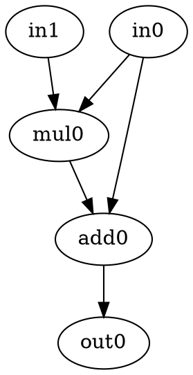

# 10 — 接入 CGRA-ME（A 阶段记录）

> 目标：用开源 CGRA 编译器（CGRA-ME，多伦多大学）替代手写微码的"调度那一层"。
> 本文只记录 **A 阶段（拿到工具、跑通最小示例）** 的结论，B/C 阶段见路线图。

## 1. 许可（重要）

CGRA-ME 不是开源许可证，而是它自带的 **EULA**：

- 仅允许 **非商业、非营利研究**；
- **禁止以源码或二进制形式再分发**；
- 不得用于商业 CGRA/软核架构开发，商业用途需作者书面同意。

因此它被放在 **仓库外**（`~/cgra-me`，24 MB），**不进入 `third_party/`、不提交**。
本项目的 arch 描述、后端与运行时是我们自己的代码，可正常入库。

## 2. 构建（本机实测）

```bash
git clone --depth 1 https://github.com/shariethernet/CGRA-ME.git ~/cgra-me   # 社区镜像
cd ~/cgra-me
env -u LD_LIBRARY_PATH cmake -S . -B build -DCMAKE_BUILD_TYPE=Release
env -u LD_LIBRARY_PATH cmake --build build -j8
```

- **不需要 LLVM pass**（`CGRA_ME_BOOTSTRAP_LLVM_PASSES` 默认 OFF）；
- 运行需要它自带的 SCIP：`LD_LIBRARY_PATH=~/cgra-me/build/lib`；
- 若扫描器/解析器与本机 flex/bison 不兼容，用本机重新生成：
  `flex -o dfgdot.yy.cc dfgdot.l` + `bison -d --defines=dfgdot.tab.h -o dfgdot.tab.cc dfgdot.y`。

## 3. CLI 的问题（已绕过）

`cgrame -x arch.xml -g dfg.dot` 会在**读完架构后 CPU 空转**（用三组独立探针复现：
不存在的 DFG、空 DFG、正常 DFG 全都挂；`-x` 单用时正常退出）。
不是 DFG 格式问题，也不是 stdin。

## 4. 库接口（可用路径）

`inc/CGRA/*.h` 的关键 API：

| 用途 | 签名 |
|---|---|
| 读架构 | `adl0::parseADL(std::string arch)` / `adl1::parseADL(template, arch)` |
| 读 DFG | `std::unique_ptr<OpGraph> parseOpGraph(std::string dot)` |
| 建 Mapper | `Mapper::createMapper(MapperType, shared_ptr<CGRA>, timelimit, args)`，`MapperType{ILPMapper=0, AnnealMapper=1}` |
| 映射 | `Mapping mapOpGraph(shared_ptr<OpGraph>, int II)`；`isMapped()` / `getII()` |

## 5. DFG 的 dot 格式（实测确定）

- 节点属性：`input=1`（输入）、`output=1`（输出）、`opcode=mul`（运算）、可选 `cycle=N`；
- 边属性：`operand=k`；
- **属性值不要加引号**：写成 `[operand="0"]` 会让解析器 `std::stoi("\"0\"")` 抛
  "Invalid argument: stoi"（CLI 卡死的真正原因）。



## 6. AnnealMapper 的参数（实测必需）

`AnnealMapper.cpp` 用 `args.at(...)` 取六个键，缺一个就抛异常：

```
AnnealMapper.random_seed / initial_pfactor / pfactor_factor /
constant_temp_factor / swap_factor / cold_accept_rate
```

## 7. 结果（A 阶段收尾）

用 30 行 C++ 驱动（`adl0::parseADL` → `parseOpGraph` → `createMapper` → `mapOpGraph`）：

```
[drv] parsing architecture...
[drv] parsing DFG...
[drv] creating mapper (Anneal) for II=1
Current Cost is: 60
Mapped: 0
[drv] mapped=no II=1
```

即 **工具链、架构解析、DFG 解析、Mapper 调用全部打通**；`mapped=no` 是退火在 40 s /
II=1 下没找到合法映射（正常结果，不是流程错误）。

### 7.1 换 `ILPMapper`（SCIP）后：纯算子 DFG 能映射成功

同一份驱动改成 `MapperType::ILPMapper`（ini 里 `ilp_solver=scip`）后，**纯算子 DFG 全部成功**：

| DFG | 算子数 | 架构 | II | 结果 |
|---|---|---|---|---|
| `add0` 单个 | 1 | simple 2×2 | 1 | `optimal` |
| `add0→add1`（operand 1） | 2 | simple 2×2 | 1/2 | mapped |
| `add0,add1→add2` 双生产者 | 3 | simple 2×2 | 1 | `optimal` |
| `fir4`（4 mul + 3 add 树） | 7 | simple 2×2 | 2 | mapped，cost 83 / 下界 78（gap 6.4%），7 个算子落在 `block_2_2_`、`block_1_1_`、`block_2_1_`、`block_1_2_` 四个 PE、0/1 两拍 |
| `fir8`（8 mul + 7 add） | 15 | simple 2×2 | 4 | mapped |
| `fir4` | 7 | **GPCP 8×8** | 1 | mapped，21 s，cost 95 / 下界 72（gap 31.9%） |

`mapOpGraph` 返回的 `Mapping` 带完整结果：`outputMapping()` 打出每个算子落在
`cycle:block_row_col.func.fu`，以及每条 val 的逐跳布线（`conN_muxM.inK → mux → out → func.in_a`）。
也就是说 **"II + 映射摘要"这条 A2 验收已经拿到**。

### 7.2 重要限制：带 `input=1` 节点的 DFG 一律判 infeasible（本版本）

对照实验（`arch-homo-diag` / `arch-homo-orth` / `arch-hetero-diag` × ILP 与退火 × II=1/2）：

| DFG | 结果 |
|---|---|
| `in0 [input=1]` 单独 | `optimal` |
| `out0 [output=1]` 单独 | `optimal` |
| `add0 → out0` | mapped |
| `in0 → add0` | **infeasible** |
| `in0, in1 → mul0 → add0 → out0`（最小 DFG） | **infeasible**（两个 mapper 都一样） |

原因在 IO 模块的内部连线（`src/core/Module.cpp:1141-1145`）：
`this.in → reg_in → OE.in`（输出方向通），`OE.out → this.bidir`（输入方向只到 `bidir`，
而阵列取数走 `this.out`，要绕 `bidir → reg_out → this.out` 两跳寄存器），这一版约束建模
没有给输入侧留出这条合法路径。

**结论（对我们的流程）**：本版本不要用 `input=1` 节点描述数据入口；真实 kernel 的入口
用 `load`/`store` 类算子（对接我们的 spad）或者干脆用纯算子 DFG 先做容量/II 评估。

### 7.3 退火映射器（AnnealMapper）的完整实验：不能用于我们的 DFG

跑法：`/tmp/drv2`（等价于 `cgra/tools/map.sh`）在 `arch-homo-orth.xml`（2×2）与
`cgra/arch/gpcp-8x8-mesh.xml`（8×8）上，II=1/2/4，时限 30/60/300 s。

| DFG | 架构 | II | 时限 | 结果 |
|---|---|---|---|---|
| `fir4`（7 算子，末 val 悬空） | 8×8 | 1 | 30 s | **段错误**（`Initial placement` 之后） |
| 单个 `add0`（无输出 val） | 8×8 | 1 | 20 s | **段错误** |
| `fir4_closed`（8 算子，含自环 sink） | 8×8 | 1 | 60 s | `mapped=no` |
| 同上 | 8×8 | 2 | 60 s | `mapped=no` |
| 同上 | 8×8 | 1 | **300 s** | `mapped=no`，cost 停在 2556（OpGraph）/1535（MRRG） |
| `fir8_closed`（16 算子） | 8×8 | 1、2 | 60 s | `mapped=no` |
| `fir4_closed` | 2×2 | 2、4 | 30 s | `mapped=no`，cost 988→909（不收敛） |

两个根因（都用 gdb 定位）：

1. **悬空 val / 无输出算子直接崩**：`AnnealMapper::routeOp`（`src/core/AnnealMapper.cpp:925`）
   对每个非 output/store 的算子无条件调 `routeVal(op->output)`，而 `routeVal`（`:365`）
   又直接解引用 `val->input`。Release 构建里 `assert` 被关掉 → 空指针。
   `cgra/tools/gen_dfg.py ... --close` 用一条 `sink -> sink` 自环把最后一个 val 接上即可不崩
   （自环在 II=1 时正好走 PE 内的寄存器，1 拍回绕）。
2. **不收敛**：即使不崩，8×8 上 300 s 的 cost 仍在 2556，比 2×2 的 909 还大；
   说明退火在"大架构 + 多输入 mux"的搜索空间里几乎没有进展（move set 只换 PE/拍，
   布线靠 `routeVal` 的贪心 BFS，找不到就整步丢弃）。

**结论**：大架构只用 **ILP（SCIP）**；退火当作"小图快速试算"的工具都不合格。

### 7.4 ILP 的实用规模阈值（8×8，全是纯算子 DFG，60~100 s 时限）

| DFG | 算子数 | 结果 |
|---|---|---|
| `fir4` | 7 | `mapped=yes`，8.7~21 s |
| `fir6` | 11 | `mapped=yes`，19 s，cost 187 |
| `fir8` | 15 | II=1（120 s、400 s）、II=2、II=4（100 s）全部 **超时且 0 个可行解** |
| `fir16` | 31 | （2×2 上 II=8/16 也超时）|

注意 `fir8` 在 8×8 上**容量绰绰有余**（15 个算子 vs 64 个 PE），超时是因为
SCIP 求**首个可行解**时根节点 LP 就要 8~9 万次迭代（26k 变量 / 32k 约束），
启发式一直没机会跑。也就是说：**瓶颈在求解策略，不在阵列规模**。

## 8. B 阶段：8×8 架构与映射验证（已落地）

依据 `docs/02` / `docs/03` 的规模估算（NR 20 MHz SISO ≈16 GOPS，8×8@500 MHz 峰值 ≈64 GOPS，
3~4× 余量），B 阶段第一步已经完成：

| 文件 | 内容 |
|---|---|
| `cgra/arch/gpcp-8x8-mesh.xml` | CGRA-ME ADL：8×8 PE（`col=10 row=10 cgra-cols=8 cgra-rows=8`，四周一圈 IO），PE = 8 输入 mux + `FuncUnit(add sub mul and or xor shl shr)` + 寄存器；N/E/W/S 四邻域 |
| `cgra/tools/cgrame_map.cpp` | 我们的库驱动（避免 CLI 空转），`[section]` 前缀展开 ini、强制 SCIP |
| `cgra/tools/map.sh` | 编译 + 运行包装（`CGRA_ME_HOME` 默认 `~/cgra-me`） |
| `cgra/tools/gen_dfg.py` | 生成 `firN` DFG（加法树 + N 个 mul） |
| `cgra/dfg/fir4.dot` / `fir8.dot` / `fir16.dot` | 示例 DFG |

用法：

```bash
env -u LD_LIBRARY_PATH python3 cgra/tools/gen_dfg.py fir 16 cgra/dfg/fir16.dot
bash cgra/tools/map.sh cgra/arch/gpcp-8x8-mesh.xml cgra/dfg/fir16.dot 1 ilp 400
# 退火要求 DFG 没有悬空输出（否则段错误，见 §7.3）：
env -u LD_LIBRARY_PATH python3 cgra/tools/gen_dfg.py fir 8 /tmp/fir8_closed.dot --close
```

实测结论：

1. 8×8 架构**能解析、能映射**（`fir4` II=1，7 个算子各占一个 PE，21 s 出解）；
2. ILP 的瓶颈是**求首个可行解**，不是容量：7~11 个算子 10~20 s 出解，15 个以上就超时
   （`fir8` 在 II=1/2/4 全部 0 可行解，见 §7.4）；
   因此工业级规模要换求解策略（热启动/对称性破除/分层映射），这也是 C 阶段后端要解决的问题；
3. 2×2 的 II 阶梯（容量对照）：`fir4` → II=2，`fir8` → II=4，`fir16` → II≥8 且 90 s 超时——
   与"每个 PE 每拍 1 个算子 + 布线占用"的估算一致，可用来反推 N×N 的规模。

## 9. 下一步（C 阶段）

1. 映射结果 → 微码：把 `Mapping` 的 `cycle:block_r_c.func.fu` 转成我们 512×512 IMEM 的
   `(cycle, pe)` 槽位，把布线转成 `src_a/src_b/link` 选择（与 `tools/cgra.py` 的
   `Program.set` 逐位对齐后才切换）；
2. spad 访问：DFG 里的 `load`/`store` 算子映射到 `spad` bank（先在 ADL 里加 memory tile，
   再在运行时做 DDR↔spad 的 DMA 双页 ping-pong，见 `docs/07` §4）；
3. 调度/交接层（M1 运行时）：`spad_acquire/release(page)`、`dma_in/out_barrier()`，
   目标是让现在卡住的"52 块串行 × 8 迭代"逐位一致（`docs/09` §4.3 的结论）。
