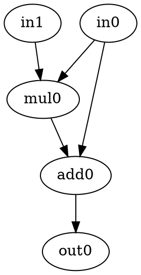

# 10 — 接入 CGRA-ME（A 阶段记录）

> 目标：用开源 CGRA 编译器（CGRA-ME，多伦多大学）替代手写微码的"调度那一层"。
> 本文只记录 **A 阶段（拿到工具、跑通最小示例）** 的结论，B/C 阶段见路线图。

## 1. 许可（重要）

CGRA-ME 不是开源许可证，而是它自带的 **EULA**：

- 仅允许 **非商业、非营利研究**；
- **禁止以源码或二进制形式再分发**；
- 不得用于商业 CGRA/软核架构开发，商业用途需作者书面同意。

因此它被放在 **仓库外**（`~/cgra-me`，24 MB），**不进入 `third_party/`、不提交**。
本项目的 arch 描述、后端与运行时是我们自己的代码，可正常入库。

## 2. 构建（本机实测）

```bash
git clone --depth 1 https://github.com/shariethernet/CGRA-ME.git ~/cgra-me   # 社区镜像
cd ~/cgra-me
env -u LD_LIBRARY_PATH cmake -S . -B build -DCMAKE_BUILD_TYPE=Release
env -u LD_LIBRARY_PATH cmake --build build -j8
```

- **不需要 LLVM pass**（`CGRA_ME_BOOTSTRAP_LLVM_PASSES` 默认 OFF）；
- 运行需要它自带的 SCIP：`LD_LIBRARY_PATH=~/cgra-me/build/lib`；
- 若扫描器/解析器与本机 flex/bison 不兼容，用本机重新生成：
  `flex -o dfgdot.yy.cc dfgdot.l` + `bison -d --defines=dfgdot.tab.h -o dfgdot.tab.cc dfgdot.y`。

## 3. CLI 的问题（已绕过）

`cgrame -x arch.xml -g dfg.dot` 会在**读完架构后 CPU 空转**（用三组独立探针复现：
不存在的 DFG、空 DFG、正常 DFG 全都挂；`-x` 单用时正常退出）。
不是 DFG 格式问题，也不是 stdin。

## 4. 库接口（可用路径）

`inc/CGRA/*.h` 的关键 API：

| 用途 | 签名 |
|---|---|
| 读架构 | `adl0::parseADL(std::string arch)` / `adl1::parseADL(template, arch)` |
| 读 DFG | `std::unique_ptr<OpGraph> parseOpGraph(std::string dot)` |
| 建 Mapper | `Mapper::createMapper(MapperType, shared_ptr<CGRA>, timelimit, args)`，`MapperType{ILPMapper=0, AnnealMapper=1}` |
| 映射 | `Mapping mapOpGraph(shared_ptr<OpGraph>, int II)`；`isMapped()` / `getII()` |

## 5. DFG 的 dot 格式（实测确定）

- 节点属性：`input=1`（输入）、`output=1`（输出）、`opcode=mul`（运算）、可选 `cycle=N`；
- 边属性：`operand=k`；
- **属性值不要加引号**：写成 `[operand="0"]` 会让解析器 `std::stoi("\"0\"")` 抛
  "Invalid argument: stoi"（CLI 卡死的真正原因）。



## 6. AnnealMapper 的参数（实测必需）

`AnnealMapper.cpp` 用 `args.at(...)` 取六个键，缺一个就抛异常：

```
AnnealMapper.random_seed / initial_pfactor / pfactor_factor /
constant_temp_factor / swap_factor / cold_accept_rate
```

## 7. 结果（A 阶段收尾）

用 30 行 C++ 驱动（`adl0::parseADL` → `parseOpGraph` → `createMapper` → `mapOpGraph`）：

```
[drv] parsing architecture...
[drv] parsing DFG...
[drv] creating mapper (Anneal) for II=1
Current Cost is: 60
Mapped: 0
[drv] mapped=no II=1
```

即 **工具链、架构解析、DFG 解析、Mapper 调用全部打通**；`mapped=no` 是退火在 40 s /
II=1 下没找到合法映射（正常结果，不是流程错误）。

## 8. B 阶段的下一步

1. 用 `II=2/3`、更长时限、或换 `ILPMapper`（SCIP）重试最小 DFG，拿到 `mapped=yes`；
2. 写 **8×8 的 arch 描述**（依据 `docs/02` 里"按协议估规模"的结论：NR 20 MHz SISO 需 ≈16 GOPS，
   8×8 才有 3~4× 余量）；
3. 用 `fir16` 的 DFG 做映射验证；再写后端（mapping → 我们的 512×512 IMEM 微码 + DMA 调度）。
